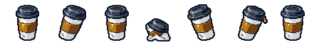

# Takeaway Cup — ranged enemy sheet

Status: **implemented; owner art/pacing acceptance remains open**, eco-guardian only. Owner selected 2026-10-23.
Stable neutral role: `enemy.ranged_attacker`. Knights and Magic stays paused.

An unbranded takeaway coffee cup: tapered cream paper body, cardboard sleeve,
dark snap-on lid and a small crease. An ordinary café silhouette, with no face,
arms, weapon or fantasy ornament. Its coffee attack is fictional gameplay;
these values do not measure persistence, toxicity or environmental harm.

| Gameplay | Base value |
| --- | --- |
| Health / armour |16 /0|
| Move speed |68 world units/second|
| Contact harm / cooldown |4 /1000ms|
| Body radius / display canvas |14 /40 world units|
| Reward |3 money|
| Introduction |66% of run, one cup; low later weight|
| Attack trigger |Within320 world units|
| Warning |1000 simulation ms; locks direction immediately|
| Release / recovery |180ms /1820ms|
| Coffee shot |8 harm,210 units/s,7 radius,1800ms lifetime|
| Shot budget |32 simultaneous hostile shots globally|

The active-wall run timer introduces the cup at3:18of a five-minute run. Enemy
movement/animation retains authored pacing; warning/cycle timings above are
movement-clock values and do not define the run clock. New cups approach until in range, stop, tip back along a visible
warning bearing, release once, then recover. They do not kite away or home shots.

**Counterplay:** sidestep after it aims, then close in during recovery. Solid
obstacles block the first shot crossing them. Defeating the cup during preparation
cancels its shot. A shot already in flight survives its shooter until hit/expiry.
Shots are consumed by contact even during the player's shared invulnerability.
Armour and world/elite harm scaling apply; they cannot hurt other enemies or
trigger player-weapon pierce, splash or kill chains. Pause freezes warning/flight.
Terminal state, quit and scene shutdown clear shots; clearing waits for live shots.

| Frame | Pose | Live use |
| --- | --- | --- |
|0|Upright, closed lid|Idle|
|1|Rock right|Movement loop|
|2|Upright hit|Short damage flash|
|3|Crushed cup/lid|Detached death visual only|
|4|Tip back left|Actual preparation phase|
|5|Tip right, coffee bead at lip|Actual release phase|
|6|Upright recovery|Actual recovery phase|

Native sheet is448×64, seven64px square cells (logical32px baseline doubled).
World canvas40/body14 are authored independently of the art. Brown shot and gold
outline/warning stay procedural so collision/timing remain truthful. No extra
projectile sprite is needed. Seven-frame attack metadata is optional; old sheets
keep idle/move/hit/death behavior. The cup never uses the player's walk cycle.

Raw a1–a4, exact prompts and metadata are preserved. **a3** is the live draft;
a1 has a weak/wrong wind-up, a2/a4 have wider death layouts. One shared323×400
source grid with virtual transparent side margins preserves original pose offsets;
no painted fixes or per-frame fitting. Measured paper-base anchors keep its feet
aligned. Native checks cover binary alpha, palette, dimensions and margins.
Idle/hit contours have small generated differences; full pixel-identical continuity
and owner art acceptance remain pending. This is deliberately a playable draft.

Use the [exact a3 generation prompt](../sprites/raw/enemy_ranged_attacker.a3.prompt.txt)
with its [recorded references/metadata](../sprites/raw/enemy_ranged_attacker.a3.metadata.json),
or copy the [subject prompt](../SPRITE_PROMPTS.md#takeaway-cup-ranged-addition).
[Verification report](../content/RANGED_ENEMY_REPORT.md) records software evidence
and the separate balance-model/art limits. No saved profile fields or migration.
